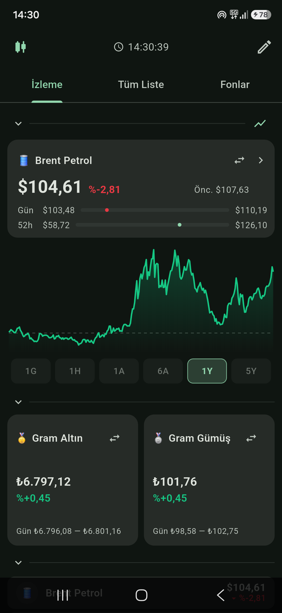
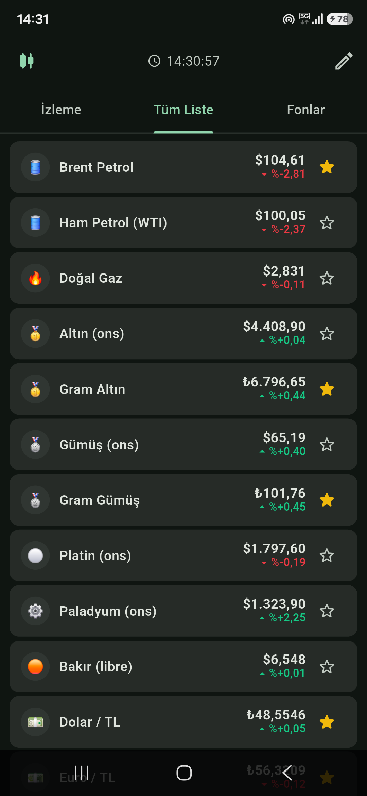
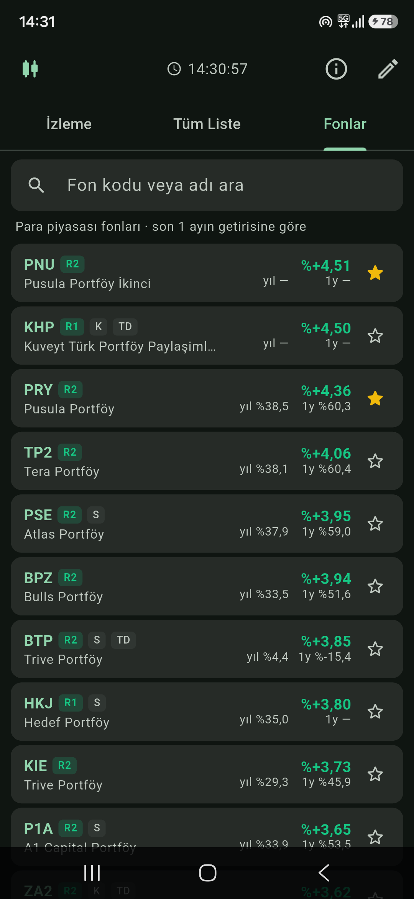
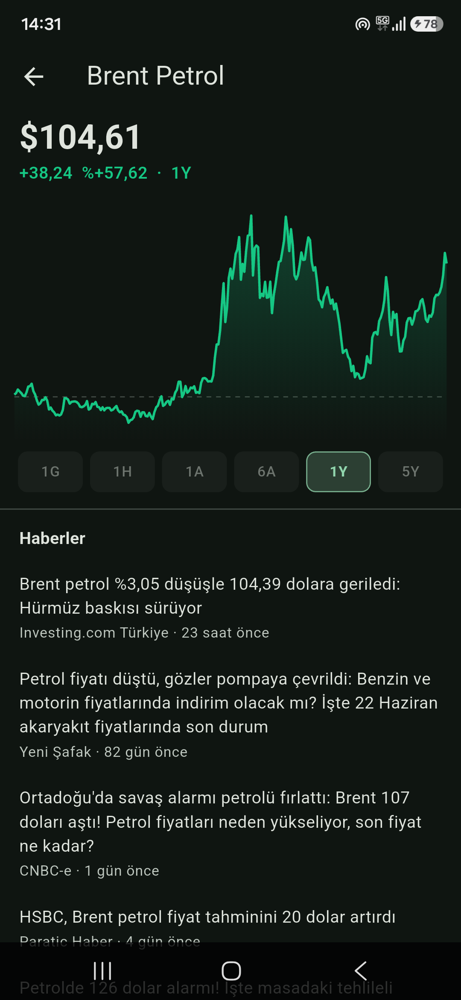
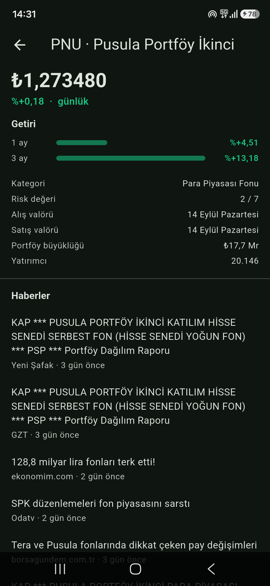

# Piyasa

Türkiye'den takip edilen finansal varlıkların güncel değerini tek ekranda
gösteren Flutter/Android uygulaması. Emtia, döviz, kripto, endeksler ve TEFAS
para piyasası fonları; her varlık için grafik ve Türkçe haber.

Arayüz tamamen Türkçe. API anahtarı gerektirmez.

| İzleme listesi | Tüm liste | Fonlar |
| --- | --- | --- |
|  |  |  |

| Varlık detayı | Fon detayı |
| --- | --- |
|  |  |

## Neler var

**İzleme listesi** — kendi seçtiğin varlıklar. En üstte tek bir odak kartı
(fiyat, günlük değişim, önceki kapanış, gün ve 52 hafta aralığı) ve tam
genişlikte grafik; altında iki ikincil kart; altında listenin geri kalanı.
Üç bölüm de açılıp kapanıyor, kartlardaki varlıklar değiştirilebiliyor ve
seçimler cihazda saklanıyor.

**Tüm liste** — 35 piyasa varlığı: Brent/WTI/doğal gaz, altın-gümüş-platin-
paladyum-bakır (ons ve gram), 5 döviz paritesi, dolar endeksi, ABD 10 yıllık
tahvil, 7 kripto, BIST 100/30/Banka, S&P 500, Nasdaq, Dow, DAX, FTSE, Nikkei,
VIX. Yıldıza dokunarak izleme listesine eklenir.

**Fonlar** — TEFAS'taki 163 para piyasası fonu, son bir ayın getirisine göre
sıralı. Kod veya ada göre arama (Türkçe harf duyarsız), risk seviyesine göre
renklenen rozetler, katılım/serbest şemsiye ve TEFAS dışı işaretleri. Fonlar da
izleme listesine eklenebiliyor.

**Detay sayfası** — 1 gün ile 5 yıl arası altı zaman aralığı, parmakla
dokununca o andaki fiyat ve tarih. Aralık seçimi tüm grafikler için ortak ve
hatırlanıyor. Altında Google Haberler'den Türkçe haberler. Fonlarda grafik
yerine dönem getirileri, risk, valör tarihleri ve fon künyesi.

Fiyatlar 60 saniyede bir, uygulama öne geldiğinde ve aşağı çekince yenilenir.
Yalnızca görünen sekmenin verisi çekilir; fon listesi günlük önbelleklenir.

## Veri kaynakları

Yahoo Finance (piyasa fiyatları ve grafikler), TEFAS (fonlar), Google Haberler
RSS (haberler). Hiçbiri anahtar istemiyor.

Uç noktaların tamamı, istek gövdeleri ve tuzaklarıyla birlikte
**[`docs/veri-kaynaklari.md`](docs/veri-kaynaklari.md)** içinde belgelendi —
yeni varlık ya da fon eklemeden önce oraya bakmak yeterli.

## Kurulum

```bash
flutter pub get
flutter run -d <cihaz>
```

Yalnızca Android hedefleniyor: haber bağlantılarını açmak için eklenti yerine
uygulamanın kendi `MethodChannel`'ı kullanılıyor (`MainActivity.kt`).

Launcher ikonunu yeniden üretmek için:

```bash
python3 tool/make_icon.py && dart run flutter_launcher_icons
```

## Bilinen sınırlar

- **Fonlarda çizgi grafik yok.** TEFAS'ın günlük fiyat geçmişi ucu doğru
  parametrelerle bile hata veriyor; yerine dönem getirileri gösteriliyor.
  Ayrıntı belgede.
- **Türetilmiş TL fiyatlarında 52 haftalık aralık gizli.** Uzun vadeli bir
  aralığı bugünkü kurla çevirmek yanıltıcı olurdu.
- **Çeyrek altın yok.** Gramdan türetince işçilik payı yüzünden piyasa
  fiyatından sapıyor.
- TEFAS uçları belgelenmiş değil; site yenilenirse fon sekmesi kırılabilir
  (hata mesajı gösterir, diğer sekmeleri etkilemez).

## Uyarı

Bu uygulama yatırım tavsiyesi değildir. Veriler üçüncü taraf kaynaklardan
gelir, gecikmeli ya da hatalı olabilir.
